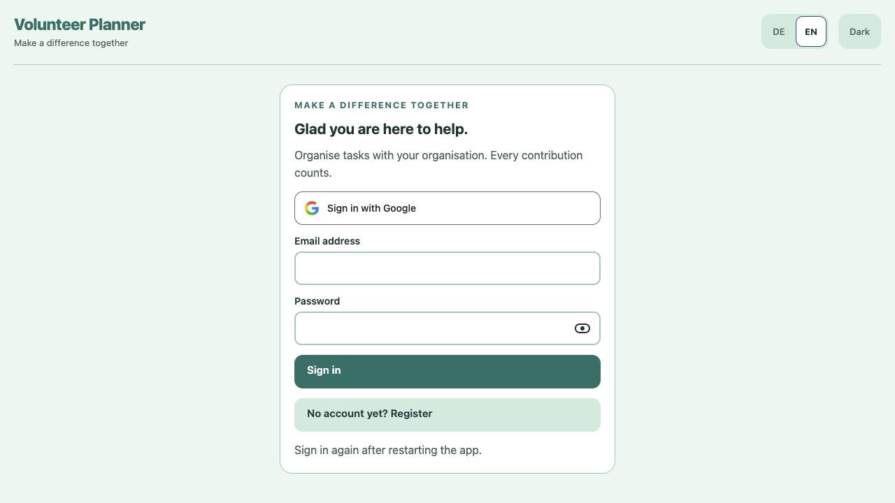
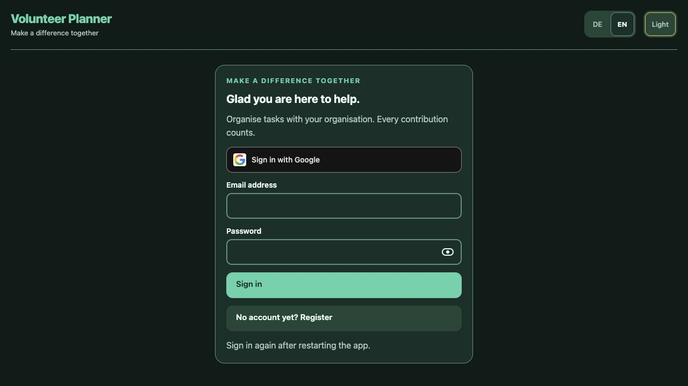

<div align="center">

# Volunteer Planner

**Work together. Keep every task in view.**

A task planner for associations and volunteer teams, with individual accounts, private organisation spaces and a shared codebase for web, Android and iOS.

[Deutsch](README.md) · **English**

[Open the live app](https://ehrenamtsplaner.vercel.app/) · [Features](#features) · [Run locally](#run-locally) · [Development status](#development-status)


</div>



## The idea

Who is taking care of a task? What is urgent, in progress or already finished? Volunteer Planner brings this information into a shared organisation space. Volunteers can take tasks, record progress and attach the documents they need.

The web version is published. Android and iOS code can be exported from the same Expo project; installable store releases are not published yet.

## Features

| Area | Capabilities |
| --- | --- |
| Accounts & organisations | Google or email/password sign-in, email confirmation, display names, private organisation spaces and confidential invitation codes |
| Tasks | Title, description, due date with calendar or manual entry, priority and visible colour swatches |
| Kanban & list | Open, Assigned, In progress and Done; button-based status changes |
| Ownership | Take and release tasks; organisation owners can assign members |
| Progress | 0–100 percent, start, pause, finish and reopen |
| Navigation | Search, status and priority filters, “My tasks”, due-date and overdue indicators |
| Documents | JPG, PNG, WebP, HEIC/HEIF and PDF up to 10 MB; private storage and recoverable upload workflows |
| Appearance | German and English interfaces, light/dark themes, saved language/theme preferences and responsive layouts |
| Accessibility | Visible keyboard focus, password visibility toggle, confirmation before discarding edits and clear feedback |

**Status rules:** Pausing preserves progress. Finishing or setting 100 percent completes a task. Releasing, reopening and reassigning reset progress. The board uses buttons rather than drag-and-drop; columns stack vertically on narrow screens.

## Screenshots

<details>
<summary>English interface in dark mode</summary>



</details>

These screenshots show the actual sign-in screen of the hosted web app, captured on 21 November 2026. They contain no sample tasks, private organisation data or credentials. German screenshots are available in the [German README](README.md).

## Technology & architecture

| Layer | Implementation |
| --- | --- |
| Interface | Expo SDK 58, React Native 0.88, React 19.3, Expo Router, TypeScript 6 |
| Authentication | Supabase Auth; Google OAuth with PKCE-S256 and a system/browser authentication dialog |
| Data | PostgreSQL with Row Level Security, organisation memberships and version checks on updates |
| Files | Private Supabase Storage bucket with upload reservations and metadata validation |
| Hosting | Vercel for the web export; Supabase project in Frankfurt |
| Quality | ESLint, TypeScript and Node test runner; PGlite database tests |

```text
src/app/              Routes and navigation, including the auth callback
src/screens/          Sign-in and task overview
src/components/       Forms, Kanban and shared controls
src/lib/              Data access, validation, translations and preferences
supabase/migrations/  Data model, access policies and database functions
tests/                Automated logic and database checks
docs/screenshots/     Actual screenshots of the published app
```

## Run locally

Requirements: Node.js 24 LTS, npm and access to the private repository. Your own installation needs a Supabase project.

```sh
git clone git@github.com:michkffm/ehrenamtsplaner.git
cd ehrenamtsplaner
npm ci
cp .env.example .env.local
```

Enter your own public Supabase configuration in `.env.local`:

```dotenv
EXPO_PUBLIC_SUPABASE_URL=https://YOUR-PROJECT.supabase.co
EXPO_PUBLIC_SUPABASE_PUBLISHABLE_KEY=YOUR-PUBLIC-PUBLISHABLE-KEY
```

```sh
npm run web
```

For the configured local callback, explicitly start on port 8081: `npx expo start --web --localhost --port 8081`.

On Android/iOS, email sign-in can be used in a compatible Expo Go version. Google requires an installed development build using the `ehrenamtsplaner` scheme; Expo Go does not support this callback. Native directories are generated by Expo rather than maintained manually.

### Supabase for your own installation

1. Create a Supabase project and run the five SQL files in `supabase/migrations/` in filename order. The existing project already records these migrations; do not rerun them there.
2. Enable email sign-in and email confirmation, and set the minimum password length to 12. Configure custom SMTP to send email to people outside the Supabase organisation; the default mail service is restricted.
3. Create a Google OAuth web client with the Supabase callback `https://<project>.supabase.co/auth/v1/callback`. Store its client ID and **client secret only in the Supabase dashboard**, then enable Google. Google's test-user restrictions apply while in testing mode.
4. Configure the Site URL and exact allowed callbacks for your installation. Current web app: `https://ehrenamtsplaner.vercel.app`; exact callback: `https://ehrenamtsplaner.vercel.app/auth/callback`. Local: `http://localhost:8081/auth/callback`. Native builds: `ehrenamtsplaner://auth/callback`.

The five migrations add the base model, task planning, private attachments, authorised deletion and upload recovery. Do not rerun existing migrations; reconcile migration history before introducing CLI-based management later.

### Deploy on Vercel

`vercel.json` defines `npm ci`, `npm run build:web`, the `dist` output directory and the application-route rewrite. The private GitHub repository is connected to Vercel. Configure both `EXPO_PUBLIC_SUPABASE_*` variables for Production in Vercel, and rebuild after changes. Preview environments require a deliberate database configuration; do not allow broad OAuth wildcards.

## Security & data behaviour

- Organisation data is separated on the server through memberships and Row Level Security. Task assignment does not expose email addresses; display names are visible to members of the same organisation. Share invitation codes confidentially.
- The publishable key is public. Secret keys, service-role keys, database passwords and Google's client secret must never appear in app code, public environment variables or commits.
- Sessions and the PKCE verifier remain in memory. Reloading or restarting requires signing in again. The browser dialog temporarily uses local storage for window coordination and the short-lived callback code, not session tokens.
- Attachments are private. Other members see files only after upload and server-side metadata checks. Interrupted transfers can restart using the same reservation; this is not byte-level resumption. Reselected files are checked by name, type and size, not a content hash. Existing files are never overwritten.
- Download links expire after five minutes. Anyone holding a link can use it until expiry. Permanent deletion requires confirmation and is restricted to the uploader or organisation owner. File signature validation is not a virus scan.
- Version numbers protect concurrent task updates. A failed refresh after a successful save never automatically repeats the write operation.

## Checks

```sh
npm run typecheck
npm run lint
npm test
npm run build:web
```

Additional checks: `npx expo export --platform web --platform ios --platform android`, `npx expo-doctor` and `npm audit`.

**Verified baseline:** 27 tests, type checking, lint and web/Android/iOS code exports passed. Tests cover organisation boundaries, permissions, progress, version conflicts, attachments, translations and Google's code exchange. PGlite tests use synthetic authentication contexts; they do not replace real Supabase multi-account or device tests.

Google sign-in was confirmed in Chrome both locally and at `https://ehrenamtsplaner.vercel.app`, through the organisation overview (21 November 2026). The Vercel production build succeeded; the homepage and direct callback return HTTP 200.

## Development status

This is an actively developed project. Remaining work includes:

- Real Android/iOS device tests, installable builds and store releases; Apple sign-in
- Full multi-account testing through the real Supabase API, including file uploads and concurrent changes
- Custom SMTP for general email registration
- Password reset, membership management, leaving organisations, invitation revocation and account deletion
- Privacy information, retention rules, backups and abuse protection
- Server-side cleanup of orphaned upload reservations and unconfirmed files
- Dependency maintenance: the Vercel build reported three moderate npm security findings and an unsupported ESLint 9 release. No forced Expo downgrade was applied.

## Licence & sources

The repository includes the Expo template's MIT notice in [LICENSE](LICENSE). An additional project-specific licence has not been chosen. The Google logo follows the [Google branding guidelines](https://developers.google.com/identity/branding-guidelines).
