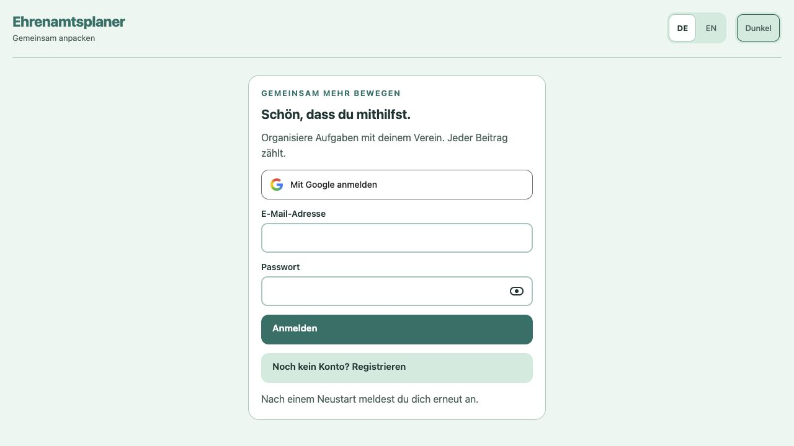
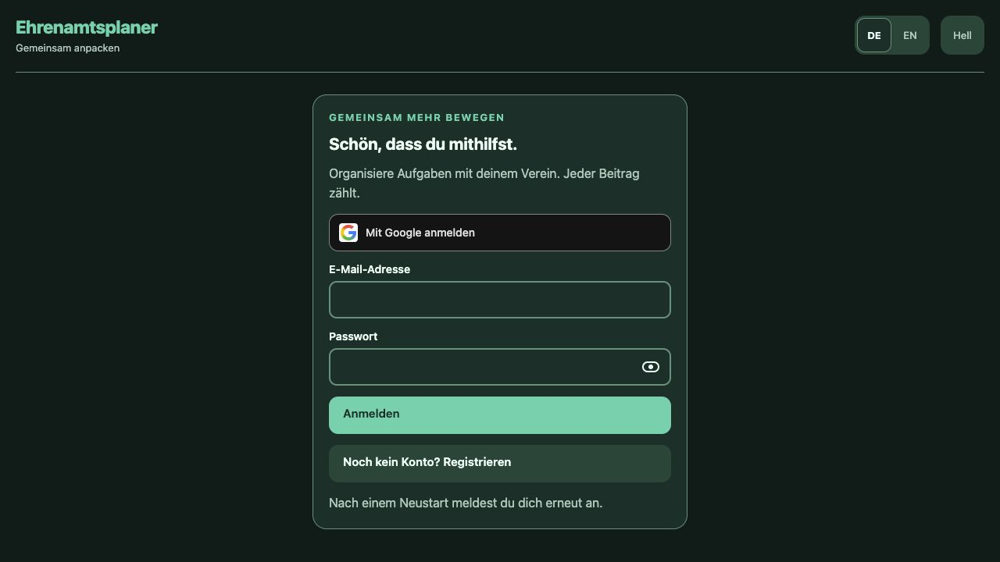

<div align="center">

# Ehrenamtsplaner

**Gemeinsam anpacken. Aufgaben im Blick behalten.**

Ein Aufgabenplaner für Vereine und ehrenamtliche Teams – mit eigenen Konten, privaten Vereinsbereichen und einer gemeinsamen Codebasis für Web, Android und iOS.

**Deutsch** · [English](README.en.md)

[Live-App öffnen](https://ehrenamtsplaner.vercel.app/) · [Funktionen](#funktionen) · [Lokal starten](#lokal-starten) · [Entwicklungsstand](#entwicklungsstand)


</div>



## Die Idee

Wer übernimmt welche Aufgabe? Was ist dringend, was läuft bereits und was ist erledigt? Der Ehrenamtsplaner bündelt diese Informationen in einem gemeinsamen Vereinsbereich. Ehrenamtliche können Aufgaben übernehmen, ihren Fortschritt festhalten und benötigte Unterlagen direkt anhängen.

Die Webversion ist veröffentlicht. Android- und iOS-Code lassen sich aus demselben Expo-Projekt exportieren; installierbare Store-Versionen sind noch nicht veröffentlicht.

## Funktionen

| Bereich | Möglichkeiten |
| --- | --- |
| Konten & Vereine | Anmeldung mit Google oder E-Mail/Passwort, E-Mail-Bestätigung, eigene Anzeigenamen, Vereinsbereiche und Beitritt per vertraulichem Einladungscode |
| Aufgaben | Titel, Beschreibung, Fälligkeit mit Kalenderauswahl oder manueller Eingabe, Wichtigkeit und sichtbare Farbauswahl |
| Kanban & Liste | Offen, Geplant, In Arbeit und Erledigt; Statuswechsel per Schaltfläche |
| Zuständigkeit | Aufgaben selbst übernehmen und freigeben; die Vereinsleitung kann Mitglieder zuweisen |
| Fortschritt | 0–100 Prozent, anfangen, pausieren, beenden und wieder öffnen |
| Orientierung | Suche, Status- und Wichtigkeitsfilter, „Meine Aufgaben“, Termin- und Überfälligkeitsanzeige |
| Unterlagen | JPG, PNG, WebP, HEIC/HEIF und PDF bis 10 MB; private Speicherung und wiederaufnehmbare Uploadvorgänge |
| Darstellung | Deutsche und englische Oberfläche, Hell-/Dunkelmodus, gespeicherte Sprache und Darstellung, responsive Ansichten |
| Bedienung | Sichtbare Tastaturfokussierung, Passwort-Auge, Rückfragen vor dem Verwerfen ungespeicherter Eingaben und verständliche Rückmeldungen |

**Statusregeln:** Pausieren erhält den Fortschritt. Beenden beziehungsweise 100 Prozent markiert eine Aufgabe als erledigt. Freigeben, Wiederöffnen und Neuzuweisen setzen den Fortschritt zurück. Das Board unterstützt Schaltflächen statt Drag-and-drop; auf schmalen Bildschirmen stehen die Spalten untereinander.

## Einblicke

<details>
<summary>Deutsche Oberfläche im Dunkelmodus</summary>



</details>

Die Screenshots zeigen die echte Anmeldung der gehosteten Web-App, aufgenommen am 21.11.2026. Sie enthalten keine Beispielaufgaben, privaten Vereinsdaten oder Zugangsdaten. Die englischen Ansichten stehen in der [englischen README](README.en.md).

## Technologie & Architektur

| Ebene | Umsetzung |
| --- | --- |
| Oberfläche | Expo SDK 58, React Native 0.88, React 19.3, Expo Router, TypeScript 6 |
| Anmeldung | Supabase Auth; Google OAuth mit PKCE-S256 und System-/Browserdialog |
| Daten | PostgreSQL mit Row Level Security, Vereinsmitgliedschaften und Versionsprüfung bei Änderungen |
| Dateien | Privater Supabase-Storage-Bucket mit Uploadreservierungen und Metadatenprüfung |
| Hosting | Vercel für den Web-Export; Supabase-Projekt in Frankfurt |
| Qualität | ESLint, TypeScript und Node-Test-Runner; Datenbanktests mit PGlite |

```text
src/app/              Seiten und Navigation einschließlich Auth-Callback
src/screens/          Anmeldung und Aufgabenübersicht
src/components/       Formulare, Kanban und gemeinsame Bedienelemente
src/lib/              Datenzugriff, Validierung, Übersetzungen und Einstellungen
supabase/migrations/  Datenmodell, Zugriffsregeln und Datenbankfunktionen
tests/                Automatisierte Logik- und Datenbankprüfungen
docs/screenshots/     Echte Screenshots der veröffentlichten App
```

## Lokal starten

Voraussetzungen: Node.js 24 LTS, npm und Zugriff auf das private Repository. Für eine eigene Installation wird ein Supabase-Projekt benötigt.

```sh
git clone git@github.com:michkffm/ehrenamtsplaner.git
cd ehrenamtsplaner
npm ci
cp .env.example .env.local
```

In `.env.local` die eigenen öffentlichen Supabase-Werte eintragen:

```dotenv
EXPO_PUBLIC_SUPABASE_URL=https://DEIN-PROJEKT.supabase.co
EXPO_PUBLIC_SUPABASE_PUBLISHABLE_KEY=DEIN-OEFFENTLICHER-PUBLISHABLE-KEY
```

```sh
npm run web
```

Für die konfigurierte lokale Rückkehradresse den Server ausdrücklich auf Port 8081 starten: `npx expo start --web --localhost --port 8081`.

Für Android/iOS kann die E-Mail-Anmeldung in einer passenden Expo-Go-Version verwendet werden. Google benötigt einen installierten Development Build mit dem Schema `ehrenamtsplaner`; Expo Go unterstützt diesen Rückkehrweg nicht. Die nativen Ordner werden von Expo erzeugt und nicht von Hand gepflegt.

### Supabase für eine eigene Installation

1. Ein Supabase-Projekt erstellen und die fünf SQL-Dateien in `supabase/migrations/` in Dateinamen-Reihenfolge ausführen. Im bestehenden Projekt sind diese Migrationen bereits erfasst; dort nicht erneut ausführen.
2. E-Mail-Anmeldung und E-Mail-Bestätigung aktivieren, Mindestpasswortlänge auf 12 setzen. Für E-Mails an Personen außerhalb der Supabase-Organisation einen eigenen SMTP-Versand einrichten; der Standardversand ist dafür eingeschränkt.
3. Für Google einen OAuth-Webclient mit der Supabase-Adresse `https://<projekt>.supabase.co/auth/v1/callback` anlegen. Client-ID und **Client Secret ausschließlich im Supabase-Dashboard** hinterlegen und Google aktivieren. Im Google-Testmodus gelten dessen Testnutzerregeln.
4. Site URL und erlaubte Rückkehradressen passend zur Installation konfigurieren. Aktueller Webbetrieb: `https://ehrenamtsplaner.vercel.app`; genauer Callback: `https://ehrenamtsplaner.vercel.app/auth/callback`. Lokal: `http://localhost:8081/auth/callback`. Native Builds: `ehrenamtsplaner://auth/callback`.

Die fünf Migrationen ergänzen nacheinander das Grundmodell, Aufgabenplanung, private Anhänge, berechtigtes Löschen und Upload-Wiederaufnahme. Bestehende Migrationen nicht erneut ausführen; bei späterer CLI-Nutzung den Migrationsstand zuerst abgleichen.

### Auf Vercel veröffentlichen

`vercel.json` legt `npm ci`, `npm run build:web`, den Ausgabeordner `dist` und die Weiterleitung für App-Routen fest. Das private GitHub-Repository ist mit Vercel verbunden. Die beiden `EXPO_PUBLIC_SUPABASE_*`-Variablen werden für Production in Vercel konfiguriert. Nach geänderten Variablen neu bauen. Preview-Umgebungen benötigen eine bewusst gewählte Datenbankkonfiguration; keine pauschalen OAuth-Wildcards freigeben.

## Sicherheit & Datenverhalten

- Vereinsdaten werden serverseitig durch Mitgliedschaften und Row Level Security getrennt. E-Mail-Adressen werden bei Aufgabenzuweisungen nicht veröffentlicht; Anzeigenamen sind für Mitglieder desselben Vereins sichtbar. Einladungscodes nur vertraulich weitergeben.
- Der Publishable Key ist öffentlich. Secret Keys, Service-Role-Keys, Datenbankpasswörter und der Google-Clientschlüssel gehören niemals in App-Code, öffentliche Umgebungsvariablen oder Commits.
- Sitzungen und der PKCE-Prüfschlüssel bleiben im Arbeitsspeicher. Nach Neuladen oder App-Neustart ist eine neue Anmeldung nötig. Der Browserdialog nutzt vorübergehend lokalen Speicher für Fensterzuordnung und den kurzlebigen Rückkehrcode, nicht für Sitzungstokens.
- Anhänge liegen in einem privaten Bucket. Erst nach Upload und serverseitigem Metadatenabgleich erscheinen sie für andere Mitglieder. Unterbrochene Übertragungen können mit derselben Reservierung neu gestartet werden; dies ist keine Fortsetzung ab Byteposition. Die erneut gewählte Datei wird anhand von Name, Typ und Größe geprüft, nicht anhand eines Inhalts-Hashes. Bestehende Dateien werden nicht überschrieben.
- Downloadlinks gelten fünf Minuten. Wer einen Link erhält, kann ihn bis zum Ablauf verwenden. Endgültiges Löschen erfordert eine Bestätigung und ist der hochladenden Person beziehungsweise Vereinsleitung vorbehalten. Dateikennungsprüfung ersetzt keinen Virenscan.
- Gleichzeitige Aufgabenänderungen werden über eine Versionsnummer abgesichert. Ein fehlgeschlagenes Neuladen nach erfolgreichem Speichern löst keine automatische Wiederholung der Schreibaktion aus.

## Prüfen

```sh
npm run typecheck
npm run lint
npm test
npm run build:web
```

Zusätzlich: `npx expo export --platform web --platform ios --platform android`, `npx expo-doctor` und `npm audit`.

**Bestätigter Stand:** 27 Tests, Typprüfung, Lint und Web-/Android-/iOS-Codeexport bestanden. Die Tests prüfen unter anderem Vereinsgrenzen, Berechtigungen, Fortschritt, Versionskonflikte, Anhänge, Übersetzungen und den Google-Codeaustausch. PGlite-Tests verwenden synthetische Authentifizierungskontexte; sie ersetzen keine echten Supabase-Mehrkonten- und Gerätetests.

Die Google-Anmeldung wurde in Chrome sowohl lokal als auch unter `https://ehrenamtsplaner.vercel.app` bis zur Vereinsübersicht bestätigt (21.11.2026). Der Produktionsbuild auf Vercel ist erfolgreich; Startseite und direkter Callback liefern HTTP 200.

## Entwicklungsstand

Die App ist ein aktiv entwickeltes Projekt. Offen sind insbesondere:

- Echte Android-/iOS-Gerätetests, installierbare Builds und Store-Veröffentlichung; Apple-Anmeldung
- Vollständige Mehrkontenprüfung über die echte Supabase-API einschließlich Datei-Uploads und paralleler Änderungen
- Eigener SMTP-Versand für allgemeine E-Mail-Registrierungen
- Passwortzurücksetzung, Mitgliederverwaltung, Austritt, Einladungswiderruf und Kontolöschung
- Datenschutzinformationen, Aufbewahrungsregeln, Backups und Missbrauchsschutz
- Serverseitige Bereinigung verwaister Uploadreservierungen und unbestätigter Dateien
- Abhängigkeitspflege: Der Vercel-Build meldete drei moderate npm-Sicherheitsmeldungen sowie eine abgekündigte ESLint-9-Version. Kein erzwungener Expo-Downgrade wurde vorgenommen.

## Lizenz & Quellen

Das Repository enthält den MIT-Lizenzhinweis des Expo-Templates in [LICENSE](LICENSE). Eine zusätzliche eigene Projektlizenz ist noch nicht festgelegt. Das Google-Logo wird nach den [Google-Branding-Vorgaben](https://developers.google.com/identity/branding-guidelines) verwendet.
